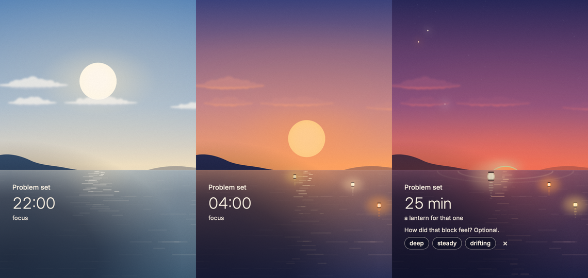
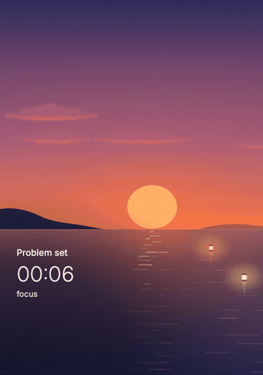
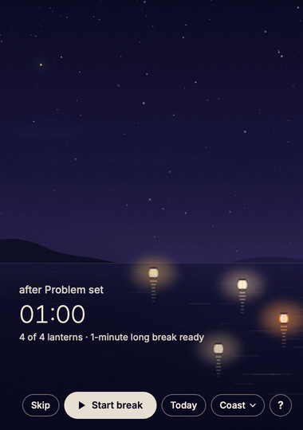
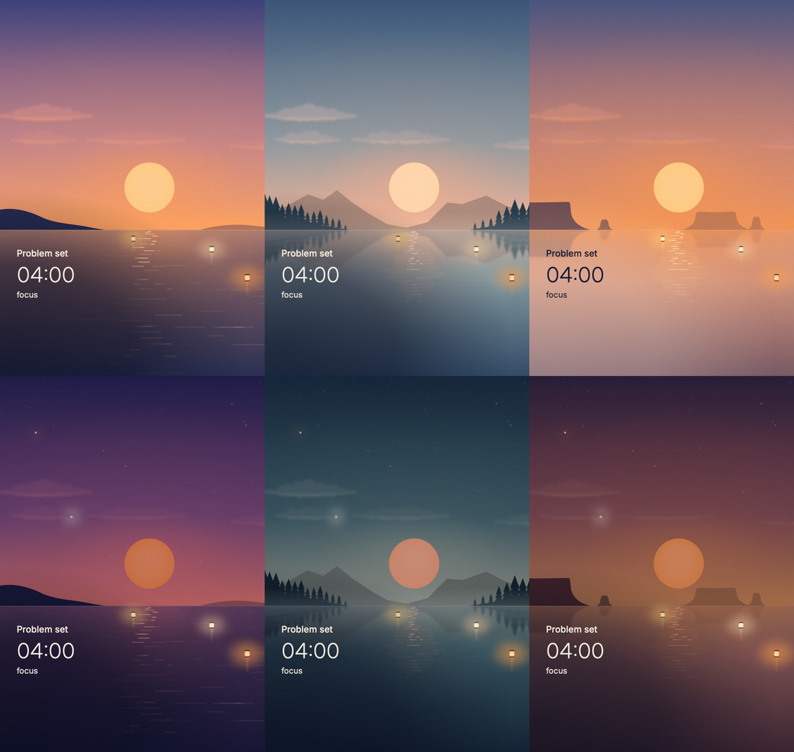
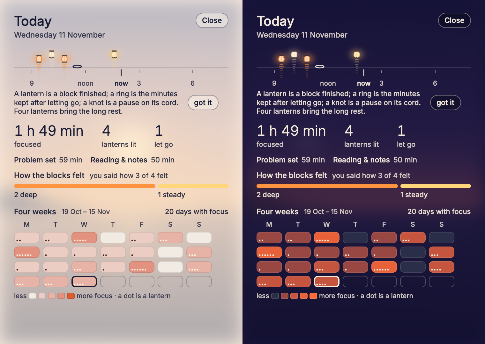

# Pomodoro

[](https://github.com/Tominthomas/pomodoro-rune/actions/workflows/ci.yml)



A pomodoro timer for macOS where each focus block is a sunset. The gap between the sun and the sea is the time you have left. When the sun touches the water, a paper lantern lights, and four lanterns earn you a long break.

I built it in [Rune](https://github.com/anomalyco/rune), a Rust UI framework that draws everything on the GPU.

Built by [Tomin Thomas](https://github.com/Tominthomas).

## Run it

The app runs on macOS. I've run it on an Apple silicon Mac with macOS 26.2.

Install the Xcode Command Line Tools if you don't have them:

```sh
xcode-select --install
```

Install Rust with rustup, then load it into your current shell:

```sh
curl --proto '=https' --tlsv1.2 -sSf https://sh.rustup.rs | sh
. "$HOME/.cargo/env"
```

Then clone the repo and run it:

```sh
git clone https://github.com/Tominthomas/pomodoro-rune
cd pomodoro-rune
cargo run --release
```

`rust-toolchain.toml` pins the Rust version, so rustup installs the right one on the first build.

To install it as an app with its lantern icon, build the bundle and copy it into Applications:

```sh
tools/bundle.sh
cp -R target/Pomodoro.app /Applications/
```

`tools/bundle.sh` builds the release binary, then writes `target/Pomodoro.app`, signed ad hoc, and `target/Pomodoro.dmg`. Only the app can post notifications. `cargo run` can't.

## How a block goes

A block starts at 25 minutes. To change it before you start, drag the sun up or down, or press the arrow keys. During a break, dragging sets the block that comes next. Press Space, click the sky, or click **Start focus** to start. While a block waits, its controls stay in sight in the bottom right; once it runs they fade until you move the pointer. The time fades too, because the sun is the timer: it always starts at the top and sinks as the minutes run out, so a short block gets the whole sunset too. Move the pointer or press Tab to see the time. It always shows while you set the length, while paused, at the bell and during a break. To keep it in sight all the time, choose View > Always Show Time.

When the sun reaches the sea, ripples spread across the water and a lantern lights. A line under the time counts the lanterns toward four, such as "1 of 4 lanterns · 5-minute break ready". The app asks how the block felt, and you can answer or ignore it. A soft, low bell rings once, so you hear the end even with another app in front. A break ends with a lighter, higher bell. Sound in the View menu turns both off.

A five-minute break waits next. Press Space or click the sky to start it. After the fourth lantern, the break is fifteen minutes, and the lanterns rise into the night. When the break ends, dawn opens the next block, which waits for you to start it.

<p align="center">
  
  
</p>

<p align="center">Left: the end of a focus block. Right: a one-minute demo break played at 3x speed. Normal long breaks default to fifteen minutes.</p>

Pausing is fine. A pause ties a small knot on the lantern's cord, and the block still counts. If you skip a block, it ends early: the minutes you kept still count and show as a ring instead of a lantern. You can undo a skip until you start the break or the next block.

## The sun in the menu bar

You can close the window and the block keeps going. A small sun sits in the menu bar by the clock, a little lower as the block goes on, with the minutes left beside it in whole minutes. It turns hollow while you pause, becomes a lantern for a short break and a moon for the long one. Click it for a menu to start, pause or skip, see today's total, turn the sound off or open the window again. Clicking the Dock icon opens the window too. To quit, press `⌘Q` or pick Quit from the sun's menu.

## Keys

Press `?` in the app to see these. The Timer, View and Help menus in the menu bar list the same actions. Every control is also a button VoiceOver can find and press.

| Key | What it does |
| --- | --- |
| `Space` | Start, pause, or resume |
| `↑` `↓` | One minute longer or shorter, while the timer waits (`→` and `←` work too) |
| `S` | Skip: end a block early (its minutes count, no lantern), or skip a break |
| `U` or `⌘Z` | Undo a skip, until you start again |
| `L` | Name the next block |
| `1` `2` `3` | How the block felt: deep, steady, or drifting |
| `H` | Today and the last four weeks |
| `T` | The next place |
| `⌘+` `⌘−` | Larger text, or back to the usual size (also View > Larger Text) |
| `Tab` | Show the controls and the time |
| `?` | All the keys |
| `Esc` | Close whatever is open |

## Any size

Drag the window's corner to make it bigger. The sky and the sea fill it, and the time and the controls keep their corners. A wide window shows Today's four weeks beside the day. The app remembers the size between launches. Larger Text in the View menu (`⌘+`) makes the words and controls bigger and leaves the sunset as it is.

## Three places

The same sunset over Coast, Lake, and Mesa. Press `T` to switch. The app follows your system's light or dark appearance. Dark mode is a later evening.



## Today and the study log

Press `H` for Today. It shows today's lanterns on a timeline, the time you focused, what you worked on, how the blocks felt, and a grid of the last four weeks. A study day starts at 4 a.m., so a late night counts toward the evening it began in.



Labels and feelings are optional. If you don't answer how a block felt, the question fades 30 seconds into the break.

Your data stays on your Mac. The app saves your blocks, settings, and current cycle in one JSON file:

```
~/Library/Application Support/dev.tomin.pomodoro/prefs.json
```

It keeps each block for 120 days. After that, it keeps only each day's totals. To start over, quit the app and delete the file.

## How it's built and checked

The whole app is Rune: the sky, the water, the lanterns, and the text are all drawn by the app on the GPU, with no web view. The timer is a state machine in `src/timer.rs`, and the window only redraws while something on screen moves.

Rune can render an app without a window, to a PNG or a video. I used that to check the app the way a person sees it. The scripts in `scripts/` replay input headless, and `tools/check.py` asserts what's on screen and what VoiceOver would read. To render any moment yourself:

```sh
cargo build --release
target/release/pomodoro --list-scenes
target/release/pomodoro --scene bell --theme dark --snap bell.png --at 2
```

The Rust tests in `src/tests/` drive the same view and key handlers through Rune's `Runtime`, which needs no GPU. They press keys, click the sky, run blocks to their end, and relaunch from what was saved, and they fail if the time or the phase line is drawn too faint to read.

`tools/ci.sh` runs every check in order: `cargo fmt`, spelling with `typos`, TOML formatting with `taplo`, unused dependencies with `cargo machete`, advisories, licenses and sources with `cargo deny`, file and folder size limits in `tools/shape.py`, `clippy`, the docs, the Rust tests, `ruff`, a check that `scripts/` matches `tools/scripts.py`, and the headless checks. CI installs the pinned versions of `typos`, `taplo`, `cargo machete` and `cargo deny`. Locally, the script skips any of them you haven't installed and says so. The headless checks need a Mac with a Metal GPU, `ffmpeg`, and `numpy`. GitHub Actions runs everything except the headless checks, because its macOS runners haven't been shown to render the app. A version tag such as `v0.1.0` (matching `Cargo.toml`) runs the Release workflow instead, which builds the app with `tools/bundle.sh` and puts `Pomodoro.dmg` on that tag's GitHub Release. Push the tag and the workflow creates the Release, or publish a Release with a new tag on GitHub's page and the workflow attaches the `.dmg` to it a few minutes later. Its Run workflow button builds one without releasing. `tools/readme-media.sh` regenerates the images on this page.

## Credits

- [Rune](https://github.com/anomalyco/rune) by Anomaly, MIT license.
- [Inter](https://github.com/rsms/inter) by The Inter Project Authors, under the SIL Open Font License 1.1. The license is in `assets/fonts/Inter-OFL.txt`.

The app is MIT licensed. See `LICENSE`.
